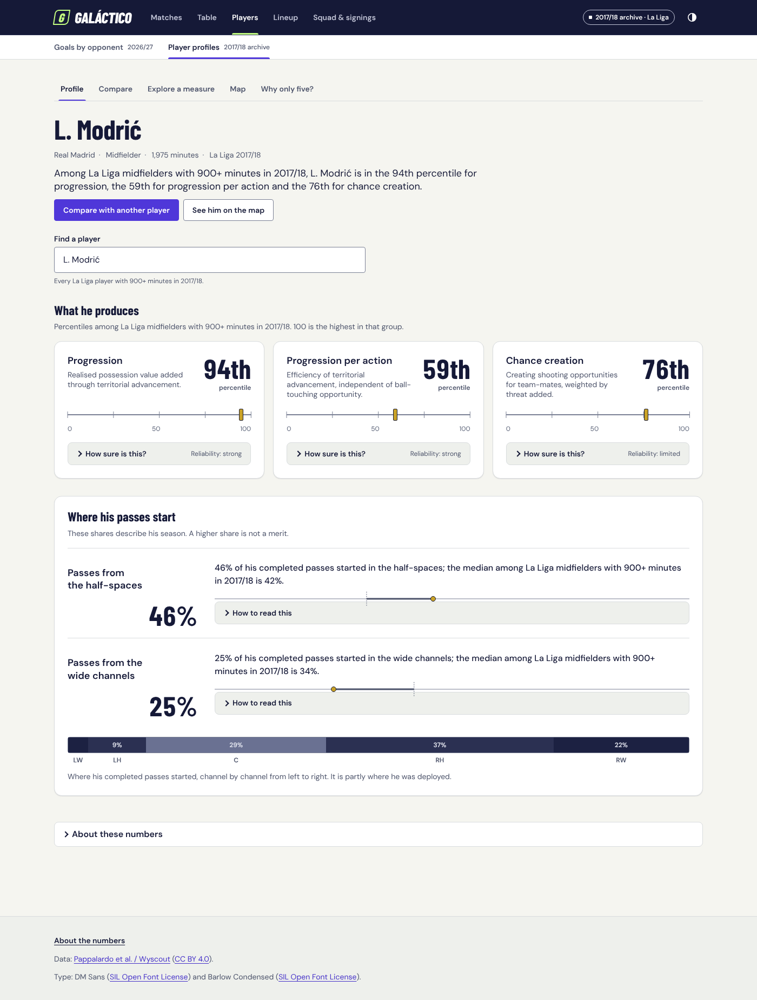
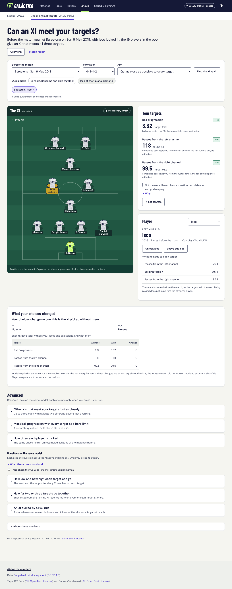
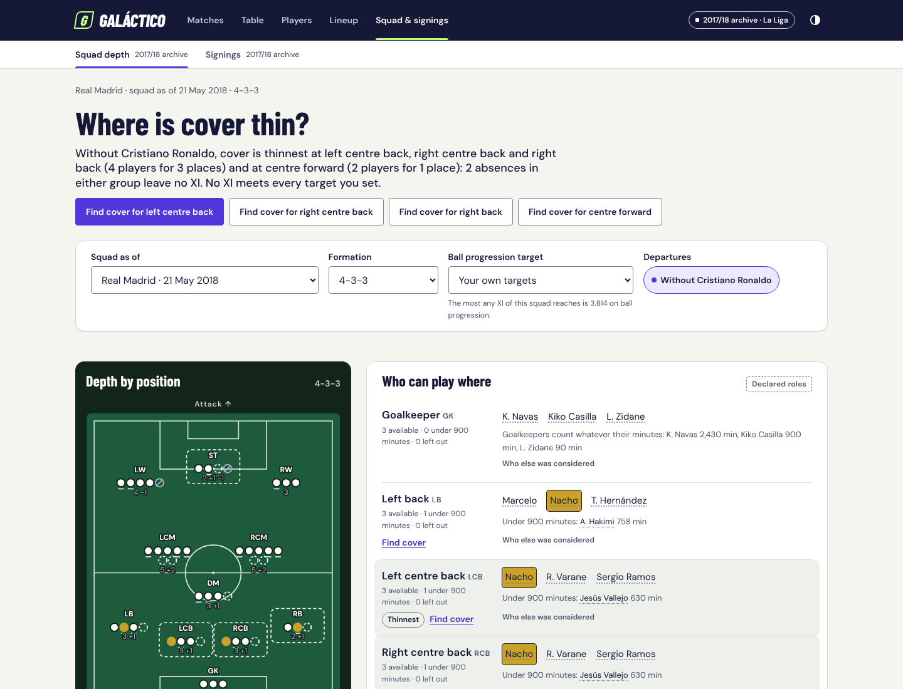
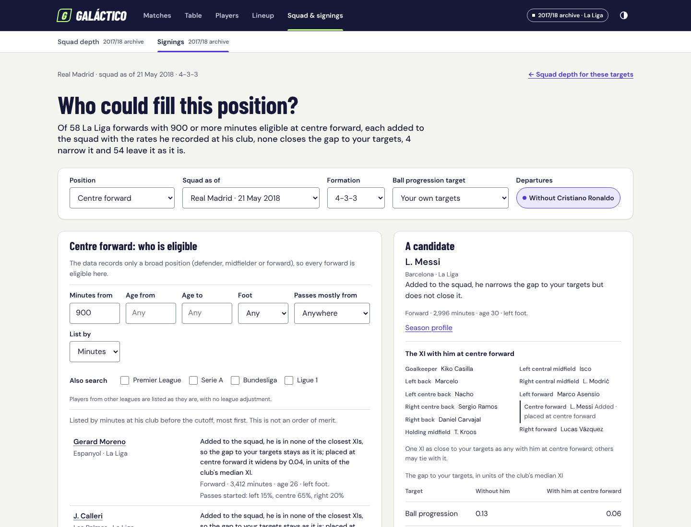
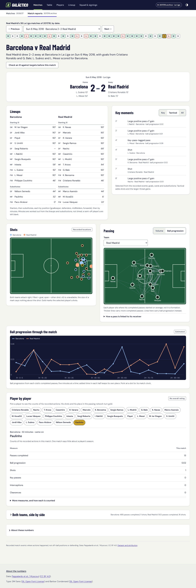

# Galáctico

An open football decision laboratory.

## One app, five places

Every page is one site with one header, one navigation and one design system, light by
default with a dark theme (ADR-0033). The navigation lists the same five places in the same
order on every page, and on a phone it is a tab bar at the bottom of the screen:

| Place | Current season (2026/27) | 2017/18 archive (local, with the corpus) |
|---|---|---|
| **Matches** | `/` and `/match-centre`: fixtures, results and match reports | `/match`: Match reports (Match Lab) |
| **Table** | `/match-centre/leagues`: tables and club schedules | — |
| **Players** | `/match-centre/scouting`: goals by opponent | `/player`: Player profiles (Player Lab) |
| **Lineup** | `/lineup`: pick and share an XI | `/xi`: Check against targets (XI Lab) |
| **Squad & signings** | — | `/squad` and `/transfer`: Squad depth and Signings (Squad Lab and Transfer Lab) |

Each place opens its current-season page first where one exists, on both apps (ADR-0035): the
Players link goes to goals by opponent, and Player profiles is the second page under it.

Every page opens the same way (ADR-0034): a chip saying which season its numbers come from,
a heading that names the page's object or question, **one answer sentence the server writes**,
then the main picture, then detail in tabs and disclosures that start closed, then "About
these numbers", closed. No football sentence is put together in the browser. The hosted site
serves the current-season pages and lists only those; the local app serves both columns. The
footer of every page links **About the numbers** (`/about`): how this season's results, tables
and goals are gathered, the data sources and licences of the pages the app serves and, on the
local app, why only five measures survive, the evidence classes, the verdict registry and what
is not measured. Old links keep working: `/?player=` opens Player profiles at `/player`, and
`/?day=` and `/?match=` open the match board. An address the app does not serve gets the
site's own "That page isn’t here" page, with the navigation as the ways on; on the hosted site
an archive address says the archive runs only on a local install. A shared link shows the
page's own description, and a shared lineup or match its server sentence, in the preview card.

## Lineup

[Open the lineup](https://galactico-sandy.vercel.app/lineup) to pick Madrid’s current XI.
The board opens on the XI the server proposes by a declared key, stated on the board: the
players with the most 2026/27 appearances in each position. Within a position a player stands
where the first position of his Wikipedia infobox puts him (left, centre or right, and
attacking or defensive for a midfielder), else by shirt number. Change shape, tap a bench
player and then the position he takes, and copy a link that opens the same lineup; saving on
the device is a convenience. Every position is named in words as well as by its short label
("LCM", "Left central midfield"). Changing shape on the proposed XI shows the server's proposal
for that shape; an edited lineup is reshaped from the formation it was edited in. A link that
names only a formation opens its proposal. The roster and all-competition appearances and goals come from
the current season’s Wikipedia tables, credited with the article's edit date. Madrid's next
fixture comes from the Matches schedule, its kick-off shown in your time zone, with a link to
the opponent's goals where the free goal feed covers its competition. A player's 2017/18 archive sample sits in a closed "Archive:
where he played in 2017/18", labelled with its match, competition and date; the role area for
a position is drawn, not measured. On a local install, import player event CSVs with 0–100
`x,y` coordinates and an optional `type` column under "Analyst tools" for your own measured
heatmap; imported coordinates stay in the browser tab. The hosted page has no import.

Live match reports use a separate [API-Football account](https://dashboard.api-football.com/).
Set `API_FOOTBALL_KEY` in the local server’s `.env`. API-Football supplies aggregates.
The studio’s measured maps require event locations.

## Goals by opponent

The public Players page answers with Real Madrid's scorers this season in every competition
(Wikipedia's counts, by goals then name), then reads OpenLigaDB’s current Champions League, Premier League and
Bundesliga match reports without an API key. It opens on Madrid's next opponent where the feed
carries its competition, else on Madrid in the Champions League, and says which. Choose a club,
split its matches by the opponent's place before kick-off (places 1–6, places 7 and below, not
yet classified; the unclassified count is shown), pick an opponent, and open a scoreline for the
recorded goal minutes. The explorer's sentence follows the opponent you pick. When no match is
classified yet, the split columns are left out and one line says why. A Real Madrid scorer is
named as the squad list names him wherever the feed's name matches one squad player by
surname and first initial (ADR-0035), so a player has one name on the page. The URL keeps the club, the split, the opponent and the scorer. The club’s reported
score and the number of named goals are shown separately; a scorer listed under two names is
joined only by a declared rule. La Liga is not offered: OpenLigaDB has no current La Liga
season, so there is no free source of its goals.
[Open goals by opponent](https://galactico-sandy.vercel.app/match-centre/scouting#goals) · [OpenLigaDB](https://www.openligadb.de/)

## Current match centre

Run `python -m pip install -e ".[api]"` and `python -m galactico.match_centre.local` from the checkout.
Open [the match centre](http://127.0.0.1:8091/match-centre). No historical data download is needed.

The public scoreboard reads this season’s fixtures and reported results for La Liga,
the Premier League, Bundesliga, Serie A, Ligue 1 and the Champions League. It opens on the
nearest day with fixtures, with one sentence on Madrid's last result (and its scorers, where the
feed names every goal) and next match. Kick-offs are shown in your time zone: the server turns
each source's published time into one instant, from the source's known zone (OpenFootball's
Premier League in UK time, its other leagues in Central European time; OpenLigaDB states UTC),
and a time whose zone is unknown is shown as published, and the page says so. One line says how
current the feeds are, the late ones flagged. A season the free feeds hold no fixtures for says
so, with a way back to today. Filter by competition, save matches across dates, or
inspect either club’s last five reported results before a fixture. **Table** opens on the
competition of Madrid's latest result, with one sentence on where Madrid stand in each of their
competitions, and shows tables from reported scores as of a chosen date, ordered by points, goal difference and goals scored, says
where Madrid stand in one sentence, and links every club’s season schedule back to individual
match reports. Each competition says how current it is from its own rows: "Results through
<date>", and "Table after matchday N of M" with the count of later fixtures without a result
where its file lags. OpenFootball publishes community-maintained season files whose scores can
lag; a Bundesliga or Premier League result they have not reported is filled from OpenLigaDB once
both clubs and the matchday match, and a result they have is never replaced. The Champions
League comes from OpenLigaDB alone. La Liga has no free fill, so its table says where its
results stop. Nothing missing is estimated.
[OpenFootball](https://github.com/openfootball/football.json) · [OpenLigaDB](https://www.openligadb.de/)

For in-play coverage, copy `.env.example` to `.env` in the checkout and set
`API_FOOTBALL_KEY` there before starting the same command. An exported environment
variable takes precedence over the file. An account with access to the relevant season and competitions is
required. Switch the source to **API-Football** for match clocks, events, lineups and
team and player totals. A match in play, on the board or in an open report, refreshes every
minute while the page is visible; nothing else is polled.
The private server binds to loopback. The regular lab server also serves the public
scoreboard at `/match-centre`.
The home page of every app is the match board (`/`, the same page as `/match-centre`), and it
accepts existing fixture links. The lineup studio is at `/lineup`. A local installation reads
the subscription key for private match reports; the source control appears only there.
[API-Football documentation](https://www.api-football.com/documentation-v3)

**Scouting** shows Madrid’s scoring and conceding rates against the rest of La Liga
from publicly reported results as of the selected date, including sample sizes and missing games.
Open it in the private match centre with a provider key to select a season, league, club and
position. For example, choose Crystal Palace midfielders and key passes, then compare
their output against opponents in places 1–6 with Madrid midfielders facing La Liga
opposition in places 1–6. Candidates are listed from the selected club’s actual player reports.
The screen shows observed minutes, missing coverage, the Madrid rate and each gap.
It ranks players on one selected need and applies no assumed league-strength bonus.

The former scouting demo, which printed invented figures beside real players' names, is
removed (ADR-0033); its old address opens the match centre.

**This season's data layer** (ADR-0036). Both apps now build one season catalogue
(`galactico/match_centre/season/`) that the coming season pages and the Real Madrid lineup
builder will read; today's pages still render from the free feeds above. With a
[football-data.org](https://www.football-data.org/) key in `FOOTBALL_DATA_KEY`, it reads that
API's free plan (twelve competitions, La Liga and the Champions League among them, ten requests a
minute) for fixtures, results, tables, squads and scorers, which closes La Liga's gap: the free La
Liga file stops weeks behind play, football-data.org does not. Its data is shown under its terms
with "Football data provided by the Football-Data.org API", held only in memory, never stored,
committed or offered for download. Real Madrid's own season (squad, appearances by match from the
article's revisions, cup ties, goals) comes from Wikipedia through the MediaWiki API, and heights
and places of birth from Wikidata. **Without the key the app behaves exactly as before:** no
request leaves for football-data.org, and the catalogue serves the six competitions OpenFootball
and OpenLigaDB carry. football-data.org's scores are delayed by an amount it does not publish, so
nothing here is called live.

## Historical decision labs

<!-- generated:counts -->
**11 proposed. 8 tested. 5 survive.**

2 rejected, 1 research-only, 3 proposed but not yet through the lifecycle.
<!-- /generated:counts -->



Five connected historical workstations run locally. Each page answers its question in one
sentence first and keeps the research tools under closed disclosures (ADR-0034); a research
answer's method sentences, certificates and ledgers sit under a closed "Technical record: how
this was worked out", so the default view is in plain words (ADR-0035):

- **Player profiles** (Player Lab) — five surviving season constructs, with shared-match uncertainty and evidence gates; the percentile among the player's position group is each measure's headline, and the view and player are in the URL. Each measure has one plain name everywhere a reader looks, from one served map (`/api/answers/measures`: "Progression" reads "Ball progression"); the raw values and intervals sit under each measure's "How sure is this?".
- **Match reports** (Match Lab) — the recorded result and its scorers first, then actual lineups, key/tactical timelines, shot locations, inferred passing networks, positive pass-xT flow and player-match contribution vectors.
- **Check against targets** (XI Lab) — "Can an XI meet your targets?" It opens on a field player, shows each target at one precision with its unit, and names the target no XI reaches when none does. Exact assignment under explicit requirements, structural deficits, lock/exclude/reoptimize, tie-aware stability, equivalent XIs and a separate progression-under-hard-floors query. Four exact additions sit under the main solve: the attainable range of each requirement, a certified minimal conflicting set when the minima cannot all hold, the nondominated sums of two or three declared requirements (never ranked), and declared-risk selection over resampled matches. The two side requirements enter them only with the experimental opt-in. Two pre-match Madrid scenarios support 4-3-3 and 4-3-1-2, including explicit BBC and Isco constraints.
- **Squad depth** (Squad Lab) — "Where is cover thin?": for a declared squad, template and minima: who is eligible where and why not, which absences raise the declared shortfall or leave no fieldable XI, and what an addition at a slot would have to supply. Real Madrid at the end of 2017/18 by default; any league club under an unreviewed position rule.
- **Signings** (Transfer Lab) — "Who could fill this position?": for a slot you declare, or the one Squad depth hands over in the link (where the targets leave no gap there, it opens on the absences Squad depth named for that position, each a removable chip, and says so): every gated player eligible there, listed by a declared factual key (minutes, age or name, never by the outcome), each added to the squad with the rates he recorded at his club and re-solved exactly, with one sentence on what that did to the gap and, under Advanced, the smallest share of his recorded rates that must carry over for the conclusion to hold. It carries rates over unchanged and says so. Whether a rate repeats after a move has not been tested.

XI Lab does **not** identify the best football XI. Its default solve finds XIs with the
least shortfall against declared progression and pass-origin requirements.
Thresholds and eligibility are inspectable rules; finishing, defensive structure,
goalkeeping quality and fitness are not modeled.



Open **Other XIs that meet your targets just as closely** under Advanced to inspect different
personnel with the same certified shortfall objective. Each alternative replaces at least two players;
the search is not a ranking or exhaustive catalogue of every optimum.
[Search contract](docs/research/XI-EQUIVALENT-ALTERNATIVES.md)

Open **Most ball progression with every target as a hard limit** for a different,
deliberately narrow question: how much summed historical passing progression can this squad accommodate
while preserving your explicit hard floors? Its own XI, floor ledger and maximizing
certificate stay separate from the main pitch and its uncertainty. Finishing,
creation, defending and keeper quality do not enter this objective. This is neither
a strongest-XI recommendation nor a complete Pareto frontier.
[Hard-floor query contract](docs/research/XI-PROGRESSION-UNDER-FLOORS.md)

Squad Lab and Transfer Lab do **not** say whom to keep, sell or sign. They are
exact arithmetic on a declared, gated model, and most of what they find about
Madrid is the gate. At the end of 2017/18 it takes three absences inside one slot
group before no XI can be fielded under the eligibility rules, and two once the
900-minute evidence gate has left five players out. Excluding Cristiano Ronaldo
leaves the declared shortfall where it was, because nothing here measures
finishing. A page that printed a shortlist would be answering a question this
data cannot. These print the question back, with what it is conditional on.
[Decisions](DECISIONS.md) ADR-0018 to ADR-0031 ·
[what they cannot say](KNOWN_LIMITATIONS.md)



Squad depth with Cristiano Ronaldo left out and a ball progression target of 4, opened from
the link `/squad?exclude=3322&target=progression:EXPLICIT:4`. The sentence is the server's:
where cover is thinnest, and what that leaves. On the pitch, one ring per player and position
he is eligible for: dashed under 900 minutes, struck when left out; a dashed box marks a
thinnest position. Gold is the selected player, at every position he can fill. Each "Find
cover" link carries the problem to Signings.



Signings on the same departure with a target of 4.2, recruiting at centre forward. The
candidates are listed by minutes played, a declared factual key the page states, never by what
the re-solve returned; each row says in one sentence what placing him there does to the gap.
The selected candidate's panel shows the exact re-solve with him; under Advanced, the
break-even carry-over fraction is the smallest share of his recorded rates that must carry over
for the conclusion to hold. It predicts nothing, and whether a rate repeats after a move has
not been tested here.

Most football analytics projects ask what statistics they can calculate.
Galáctico first asks whether the statistic means what its name implies.

That question has killed more metrics here than noise has.

---

## Three ways a football metric fails

**Metronome Fit** — reliable, and measuring the wrong thing. Split-half **0.94**,
higher than expected threat, with a leaderboard of Kroos, Iniesta, Busquets and
Modrić. Exactly the players you would name. It was measuring touch volume: among
deep players it correlated **0.93** with raw touch count, and touch volume plus
team identity explained ~90% of its variance. A preregistered replication on a
different provider and season did not reject it either — two of five tests failed
and the frozen rule required a different combination. It is not shipped, and it is
not closed. [E-01](docs/research/E-01-metronome-fit.md) ·
[E-02](experiments/preregistered/E-02-metronome-confirmatory/analysis.md)

**Ball retention** — reliable, honest, and redundant. Reliability 0.87–0.90 in all
five leagues, and a **0.93–0.95** correlation with plain pass completion
percentage in every one of them. The threat-weighting that justified its existence
moved about 5% of its variance. Pass completion already exists and is simpler.
[E-03](docs/research/E-03-ball-retention-incremental-value.md)

**Verticality** — reliable, and mostly geometry. Reliability 0.97, and roughly
**83%** of its variance is where the player receives the ball. Within a
field-position stratum the relationship largely vanishes.

Reliability tells you a measurement is repeatable. It does not tell you what is
being repeated.

---

## What survives

<!-- generated:claims -->
- **Progression** — Realised possession value added through territorial advancement.
- **Progression per action** — Efficiency of territorial advancement, independent of ball-touching opportunity.
- **Chance creation** — Creating shooting opportunities for team-mates, weighted by threat added.
- **Half-space pass-origin share** — Share of completed passes originating in the defined half-space channels.
- **Wide-channel pass-origin share** — Share of completed passes originating in the defined wide channels.
<!-- /generated:claims -->

<!-- generated:constructs -->
| Construct | Family | Denominator | Minutes floor | External replication |
|---|---|---|---:|---|
| `progression` — Progression | quality | per 90 minutes | — | robust with shift |
| `progression_per_action` — Progression per action | quality | completed passes | — | robust with shift |
| `chance_creation` — Chance creation | quality | per 90 minutes | 1800 | robust with shift |
| `half_space_share` — Half-space pass-origin share | style | completed passes | — | robust with shift |
| `width` — Wide-channel pass-origin share | style | completed passes | — | robust |
<!-- /generated:constructs -->

The two spatial constructs are deliberately named after what enters the numerator.
They describe **where completed passes originated**, which includes where the
player was deployed. They do not establish a preference — that would need
[E-04](experiments/preregistered/E-04-conditional-spatial-tendency/preregistration.md),
which has not been run. Calling them "width" and "half-space preference" would
repeat the verticality error with a different name.

<!-- generated:rejected -->
| Construct | Status | Why |
|---|---|---|
| `ball_retention` | rejected | Too similar to ordinary pass completion |
| `verticality` | rejected | Mostly explained by starting field position |
| `metronome_fit` | research only | Construct validity unresolved after preregistered replication |
<!-- /generated:rejected -->

**There is no overall rating**, and a test fails the build if one appears.

---

## Running it

```bash
uv venv
uv pip install -e ".[dev,api]"
uv run python scripts/fetch_pappalardo.py
uv run python scripts/prepare_lab.py
uv run python scripts/prepare_planning.py
uv run uvicorn galactico.api.player_lab:app --host 127.0.0.1 --port 8090
```

Open `http://127.0.0.1:8090/player`, `/match?id=2565907`, `/xi`, `/squad` or `/transfer`
(`/` is the current-season match board on this app too).
Four labs run on Spain alone (`fetch_pappalardo.py --only Spain`, then
`prepare_lab.py`). Transfer Lab needs all five leagues, because a candidate's club
is the club of his latest appearance in any of them; without them it answers 503,
and Squad Lab serves its role brief without the candidate count and says so.
The first match/snapshot request loads the historical corpus and fits its xT surface;
The XI page's main solve asks for no resampled season. "How often each player is picked"
asks for 12 shared worlds only when it is opened; they are deliberately coarse exploratory
diagnostics. They report **necessary–possible frequencies across equally optimal solutions**,
not probabilities of being the best player. More worlds are available through the API.

```bash
uv run ruff check galactico tests scripts
uv run pytest -q
uv run python scripts/check_licensing.py
npm install
npx playwright install chromium
npm test
```

Playwright starts its own local server and tests the actual historical data surfaces.
`npm test` runs every spec. `e2e/labs.spec.js` (also in `make e2e`) and
`e2e/screenshots.spec.js` rewrite the tracked images under `docs/screenshots`:
`git restore docs/screenshots` afterwards unless the change is intended and inspected.
`make install`, `make prepare`, `make serve`, `make check` and `make e2e` are shortcuts
where Make is available. No API key is needed for this public historical release.

Every test stubs the current-season sources. `uv run python scripts/upstream_smoke.py` asks each
live one (OpenFootball, OpenLigaDB, the Wikipedia squad page) once through the project's own
feed code and prints its status, row count and latest result date; a failed or empty source
fails it. With `FOOTBALL_DATA_KEY` set it also asks football-data.org three times (the
competitions, one table, the day) and checks each reply against the field-names contract,
printing counts only; without the key that row says "skipped". `.github/workflows/upstream-smoke.yml`
runs it once a day, apart from the test job, with the key from the repository secret
`FOOTBALL_DATA_KEY` (added by the repository's owner, never committed). No test calls
football-data.org: under pytest a client without an injected transport is off.

The repository contains **no football data**. Corpora are downloaded at runtime
into a gitignored cache under each provider's own terms, and a CI guard fails on
any attempt to commit one.

---

## Where the data comes from, and what it costs

| Tier | Source | Licence |
|---|---|---|
| LAB, public | Pappalardo/Wyscout 2017/18, five leagues | CC BY 4.0 |
| LAB, local only | StatsBomb open 2015/16, four leagues | restrictive EULA |
| VISION | SkillCorner, DFL/Sportec | MIT, CC BY 4.0 |
| This season, public | OpenFootball, OpenLigaDB, English Wikipedia, Wikidata | CC0 1.0, ODbL 1.0, CC BY-SA 4.0, CC0 1.0 |
| This season, hosted display | football-data.org API v4, free plan (with a key) | its terms: shown with its credit, never redistributed or committed ([LICENSING](LICENSING.md)) |


Data source: **StatsBomb** open data, read locally under the StatsBomb Public Data
User Agreement. Two things on this page are analysis formed from StatsBomb data and
carry the StatsBomb logo as clause 1.4 of that agreement requires: the Metronome Fit
result ([E-01](docs/research/E-01-metronome-fit.md)) and the external-replication
column of the construct table
([Stage 1C](docs/research/STAGE-1C-EXTERNAL-REPLICATION.md)). A hosted instance serves
the external-replication labels and the Metronome Fit conclusion, with this credit,
and no StatsBomb-derived number. No StatsBomb data is in this repository, and no
machine-readable table derived from it is in the tree. The StatsBomb-side figures
printed here are published analysis.

All five shipped labs are **historical**. They run on 2017/18 event data and carry the season
chip "2017/18 archive · La Liga" in the interface. A LIVE regime would use a different estimator with different
uncertainty and different sample thresholds, which is why constructs and
estimators are separate objects in the registry.

Two things verified and closed: **FotMob** exposes a season-scope shotmap with
coordinates, and its terms and `robots.txt` forbid the use — it is Opta underneath,
unhidden. **UEFA** publishes exactly the physical metrics this project wanted,
through keyless JSON, and clause 6.2 of its terms bars systematic collection,
scripted access, and using the content to develop or train any model. UEFA carries
the `REFERENCE_ONLY` tier in the provider registry. FotMob has no entry there;
[LICENSING](LICENSING.md) lists it among the sources not used. Neither has an
adapter. **No LIVE model is shipped; its planned scope excludes a physical axis
without a permitted source.**
[FotMob](docs/research/FOTMOB-RECON.md) ·
[UEFA](docs/research/UEFA-PHYSICAL-DATA.md) ·
[gap matrix](docs/LIVE-DATA-GAP-MATRIX.md)

---

## State

| Stage | | |
|---|---|---|
| 0 | Foundations | complete |
| 1 | Measurement — five leagues | complete |
| 1B | Replication + reconnaissance | complete |
| 1C | External provider + season shift | complete |
| 2 | Player Lab | frozen since ADR-0011, except the corrections of ADR-0025 and ADR-0027 (October 2026) and the answer-first page of ADR-0034 (markup and copy; the API is unchanged); statistical/API/browser gates repaired and verified |
| Match | Match Lab | public historical v1 implemented |
| 3 | XI Lab | experimental requirement engine implemented |
| 4 | Squad Lab / Transfer Lab | exact tools implemented; nothing about carry-over is validated |
| Next | Opponent Lab, five drafted protocols | [drafted, not frozen, not run](docs/research/north-star/README.md) |

Independent agent reviews and actual browser inspection were performed. External
human football/statistical acceptance has **not** been claimed; `make release-check`
keeps that distinction explicit. Implementation status is not decision validation.

Two important negative results accompany this release:

- A role-standardized match-score candidate correlated **0.988 / 0.982** with ordinary positive pass-xT in Spain / England. It is a renamed reference scale, not an identified overall contribution score. Match Lab stays vector-valued. [E-05](docs/research/E-05-match-score.md)
- In 12 late-season Madrid fixtures, the requirement engine's representative XI matched **6.00** actual starters on average, below the eligible prior-minutes baseline's **6.83**. This development diagnostic measures manager agreement, not counterfactual quality. [E-06](docs/research/E-06-lineup-requirements.md)

The next preregistered forecast study could not fit its model: requiring all ten
starters to meet the current evidence floor left **3 development observations**, below
the frozen minimum of 50. No forecast skill or failure is inferred from that lack of
coverage. [E-07](experiments/preregistered/E-07-lineup-transport/analysis.md)

The partial-history follow-up reached **272 development observations**, but
development-only tuning selected **context only**, not any player-history variant.
Incremental prediction was not established; no learned XI rating ships.
[E-08](experiments/preregistered/E-08-partial-history/analysis.md)



Shots have no invented xG. Networks identify inferred rather than observed
recipients. Threat flow is positive completed-pass xT, **not momentum**.
[Capability matrix](docs/research/MATCH-INTELLIGENCE-CAPABILITY-MATRIX.md) ·
[Exact continuation checkpoint](docs/ASTRA-CHECKPOINT.md)

---

## Method notes

The failures were more instructive than the successes, so they are kept.

- [M-01](docs/research/M-01-self-consistent-tests-can-be-wrong.md) — a test suite can be consistent with the code while both are wrong about reality
- [M-02](docs/research/M-02-definition-code-divergence.md) — a metric can be validated and stable while its public definition describes a different quantity
- [M-03](docs/research/M-03-shell-is-not-product.md) — a 200 response is not a working application
- [M-04](docs/research/M-04-shared-match-worlds.md) — independent teammate bootstraps destroy the covariance needed for comparisons
- [M-05](docs/research/M-05-optimizer-selection-bias.md) — exact optimization still selects positive estimation noise
- [M-06](docs/research/M-06-a-guard-that-never-runs.md) — the test behind "no overall rating" had never run in CI
- [M-07](docs/research/M-07-rank-ties.md) — a rank correlation that changed with the order of the rows; an erratum to the published figures
- [M-08](docs/research/M-08-reliability-pool.md) — a reliability served on outfield rows had been taken over a pool with goalkeepers in it

Every one is the same shape: **verification placement matters as much as
verification existence.**

Full results: [Stage 1](docs/research/STAGE-1-MEASUREMENT-REPORT.md) ·
[Stage 1B](docs/research/STAGE-1B-REPLICATION-REPORT.md) ·
[Stage 1C](docs/research/STAGE-1C-EXTERNAL-REPLICATION.md) ·
[decisions](DECISIONS.md) · [limitations](KNOWN_LIMITATIONS.md)

---

## Licence

MIT, for the code.
